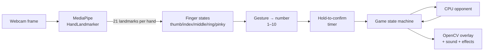

# 🏏 Hand Cricket CV

**Play hand cricket against an AI using only your webcam and your fingers.**

[](https://github.com/Ishaan7497/Odd_or_Eve_CV/actions/workflows/tests.yml)


[](LICENSE)

---

## About

**Hand cricket** (also called *Odd or Even*) is a game played across South Asia with nothing but your hands. Each player throws out a number of fingers at the same time. The batter scores the number they showed, unless the bowler shows the same number, in which case the batter is **out**. The second player then bats and tries to beat the first score.

This project turns that playground game into a real-time computer vision application. A webcam feed is processed by Google's **MediaPipe HandLandmarker** model, which finds 21 3-D landmarks on each hand. The game then works out which fingers are extended, turns that into a number from 1 to 10, and plays a full match against a CPU opponent. There's no keyboard or mouse in the loop: menus, the toss, batting, bowling and even quitting are all controlled by hand gestures.

Some of the problems it solves:

- **Reliable gesture reading.** Finger states are measured *relative to the size of the palm*, so recognition works whether your hand is close to the camera or far away, and anywhere in the frame.
- **No accidental inputs.** A gesture only counts once it has been held steadily (shown by a filling ring). Changing the gesture, losing the hand or moving to a new screen resets the timer.
- **An opponent that adapts.** On Medium and Hard, the CPU tracks the numbers you've played recently and uses them against you: bowling your favourite number to get you out, and avoiding it when it bats.
- **A complete match engine.** Coin toss, innings, target chasing, early finishes, tie-break super overs and milestone celebrations, all built as a state machine.
- **Tested edge cases.** Over 230 automated tests cover gesture recognition, scoring, the AI, match flow and rendering, and they run on every push with GitHub Actions.

---

## Features

| | |
|---|---|
| ✋ **Gesture input** | Numbers 1–10 from one or two hands, recognised in real time |
| 🎮 **3 match formats** | Classic (1–6), Extended (1–10) and **Crazy** (adjacent numbers = out, same number = runs squared) |
| 🧠 **3 AI levels** | Easy (random), Medium (notices your patterns), Hard (actively counters you) |
| 🪙 **Full match flow** | Odd/even coin toss → bat or bowl → innings break → chase → result |
| ⚡ **Super over** | Tied matches go to a 6-ball-per-side super over |
| 🎉 **Celebrations** | Fifties, hundreds, wickets and wins with particles, confetti and crowd audio. Raise your hand to celebrate |
| 🔊 **Audio** | Synthesised sound effects, with optional real audio clips and background music |
| ✊ **Gesture quit** | Hold two fists for 3 seconds to exit, with no keyboard needed |

---

## How it works



**1. Finger detection.** For each finger, the game compares how far the fingertip is from the wrist with how far the middle joint is from the wrist. If the tip is farther away, the finger is extended. The thumb counts as extended when its tip is well away from the index knuckle. All distances are scaled by the palm size, which keeps detection stable at any distance from the camera.

**2. Gesture → number.** The five finger states form a pattern such as `(thumb, index, middle, ring, pinky) = (0, 1, 1, 0, 0)` → **2**. Two closed hands held together means **10**. Any pattern that isn't in the table, or a number that isn't allowed on the current screen, is ignored.

**3. Hold to confirm.** A number is accepted only after it has been held steadily for ~1.3 seconds. This filters out the flicker you get while your hand is moving between gestures.

**4. The CPU.** The CPU always chooses *before* it sees your current gesture. On Medium and Hard it looks at your previous few moves:

| Level | When bowling | When batting |
|---|---|---|
| Easy | Random | Random, slightly favouring big numbers |
| Medium | Sometimes bowls your most common number | Sometimes avoids your most common number |
| Hard | Often bowls your most common number | Often avoids it, and swings for big numbers |

**5. Match engine.** The game runs as a state machine:
`MODE_SELECT → DIFFICULTY_SELECT → TOSS → PLAYING ⇄ BALL_RESULT → INNINGS_BREAK → … → GAME_RESULT`.
The logic that decides what happens after each ball (innings over, chase won, super over) is a pure function, `end_of_ball_update()`, so it can be tested on its own.

---

## Getting started

**Requirements:** Python 3.9+, a webcam.

```bash
git clone https://github.com/Ishaan7497/Odd_or_Eve_CV.git
cd Odd_or_Eve_CV
pip install -r requirements.txt
python OoE_CV.py
```

The hand-tracking model (`assets/hand_landmarker.task`) comes with the repo. To use a different copy, set the `HAND_LANDMARKER_PATH` environment variable.

> **macOS:** the first time you run it, allow your terminal to use the camera in
> *System Settings → Privacy & Security → Camera*.

---

## How to play

### Gestures

| Number | Gesture |
|:---:|---|
| 1 | Index finger |
| 2 | Index + middle |
| 3 | Index + middle + ring |
| 4 | Four fingers, thumb folded |
| 5 | Open hand |
| 6 | Thumb only 👍 |
| 7 | Thumb + index |
| 8 | Thumb + index + middle |
| 9 | Thumb + index + middle + ring |
| 10 | Both hands closed, held together |

Hold the gesture until the ring in the top-right corner fills.

### Rules

1. **Choose a format** (show 1, 2 or 3 fingers) and a **difficulty**.
2. **Toss:** call odd (1) or even (2), then show 1 or 2 fingers. The CPU does the same, and the sum decides who wins. The winner chooses to bat (1) or bowl (2).
3. **Batting:** you score the number you show. If the CPU shows the same number, you're **out** and the innings ends.
4. **Bowling:** try to match the CPU's number to get it out.
5. **The chase:** the second innings ends when the batter is out or passes the target.
6. **Tie?** A **super over** follows: 6 balls each, and getting out costs that ball's runs but doesn't end the over.

**Crazy mode:** numbers next to each other (e.g. 4 vs 5, or 10 vs 1) are **out**. Showing the *same* number scores its **square** (7 vs 7 = 49 runs!).

### Controls

| Action | How |
|---|---|
| Confirm | Hold a gesture until the ring fills |
| Quit | Hold **two fists** for 3 seconds, or press **Esc** / **Q**, or close the window |
| Play again | Show **1** on the result screen (show **2** to quit) |

### Optional audio

Put `bgm.mp3` (or `.ogg`/`.wav`) in `assets/` for background music. Any sound effect can be replaced by adding a file with the same name, e.g. `assets/crowd_cheer.mp3`.

---

## Testing

```bash
pip install -r requirements-dev.txt
pytest
```

The test suite (`tests/`) needs no webcam. It feeds the game synthetic hand landmarks and a fake clock, and checks:

- **Gestures:** every number, at different hand sizes and positions; unknown, out-of-range and broken (all-zero) hands
- **Scoring:** every possible pair of numbers in every mode
- **AI:** always picks a legal number; Hard measurably punishes predictable players
- **Match flow:** first-ball wickets, exact-target ties, chases, super overs, and one ball jumping past both 50 and 100
- **Timing:** hold-to-confirm and the two-fist quit gesture, including interruptions
- **Rendering:** every screen and effect at window sizes from 320×240 to 1920×1080
- **Assets:** missing model, bad environment variable, asset lookup order

Tests run automatically on GitHub Actions for Python 3.10 and 3.12.

---

## Project structure

```
.
├── OoE_CV.py              # the game: gestures, AI, match engine, UI, audio
├── assets/
│   ├── hand_landmarker.task   # MediaPipe hand-tracking model
│   └── *.mp3                  # crowd and stumps sound clips
├── tests/                 # pytest suite (no webcam required)
├── requirements.txt
├── requirements-dev.txt
└── .github/workflows/     # CI
```

## Built with

- [OpenCV](https://opencv.org/): camera capture, drawing and UI
- [MediaPipe](https://ai.google.dev/edge/mediapipe/solutions/vision/hand_landmarker): hand landmark detection
- [NumPy](https://numpy.org/): geometry and sound synthesis
- [pygame](https://www.pygame.org/): audio playback
- [pytest](https://pytest.org/) + GitHub Actions: testing

## Ideas for the future

- Two-player mode (one hand each, same webcam)
- Wickets and overs settings for longer matches
- A "3-2-1 show!" countdown so both sides reveal at the same moment
- Saved high scores and stats

## License

[MIT](LICENSE) © Ishaan Gupta
